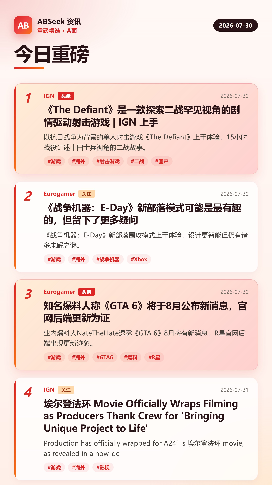
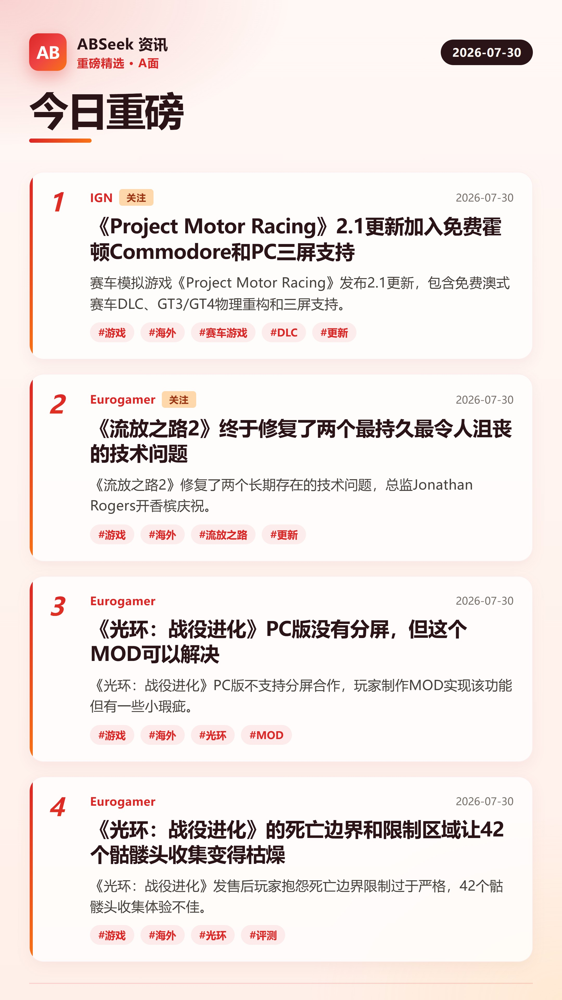
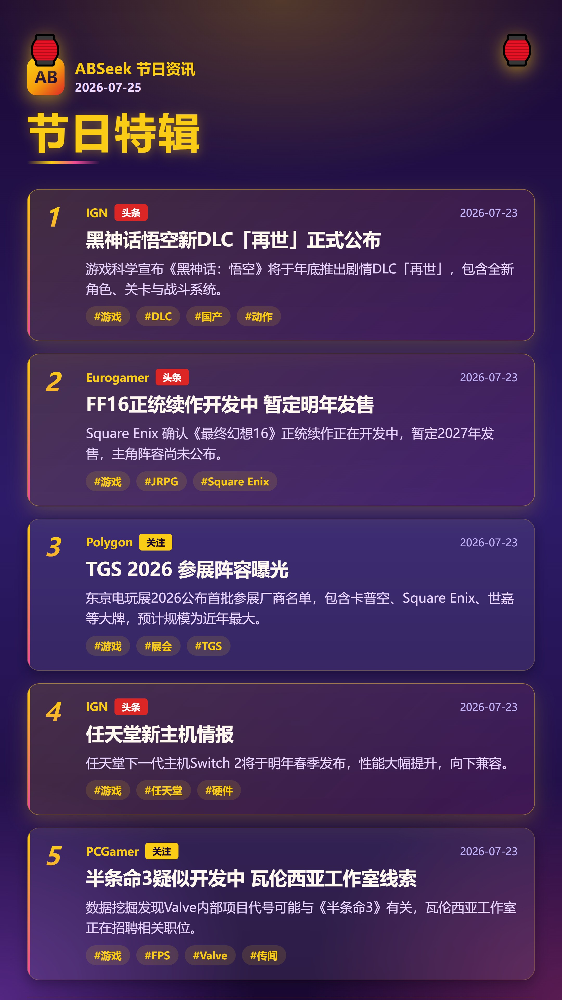

# ABSeek

> 把散落在各处的新闻，变成一张张可直接发布的精美资讯图。

[English](./README_EN.md) | 中文

ABSeek 是一款**本地化**的新闻信息汇总出图工具，帮助内容创作者将多源新闻采集、整理、人工调整后，快速生成适合移动端浏览的图片，用于社交网络发布。

- 全本地运行，数据归你（简讯即 Markdown 文件）
- AI 友好协作（外部 AI 工具可直接读写加工）
- 模板化出图（HTML/CSS 模板，所见即所得）
- 属性驱动分流（一条简讯按属性自动匹配模板，一次生成多张图）
- 零外部服务（不用 Docker / 数据库 / 服务器）

---

## 功能特性

### 采集
- 支持 RSS 源（ign / eurogamer / polygon 等）和静态网页爬取
- 定时调度（node-cron）自动采集，支持代理
- 自动去重（URL + 内容哈希双索引）

### 简讯管理
- 简讯以 Markdown 文件落地（YAML frontmatter + 正文）
- 字段：标题 / 摘要（中英双语）/ 标签 / 分类 / aspect（A/B 面）/ 状态 / 自定义属性
- 状态机：raw → processed → reviewed → exported
- 非游戏行业消息可标记 `excluded` 自动跳过

### 模板出图
- HTML/CSS 模板，支持 Handlebars 模板语法
- 按 aspect 属性自动绑定模板（`default-bindings.json`）
- 分页输出（每页最多 N 条，超出自动分页）
- 多语言输出（zh / en，缺失语言自动 fallback）
- 输出 9:16 竖图（1080×1920），适合移动端浏览

### 自动化
- 双独立定时任务（采集 + 出图）
- 运行状态持久化，支持失败重试
- 历史记录保留 50 条

---

## 工作流程

```
RSS 源 / 网页爬取
        │
        ▼
   自动采集入库（raw 简讯）
        │
        ▼
   Agent 处理（翻译 / 行业判断 / AB 分面 / 打标）
        │
        ▼
   人工审核调整（可选）
        │
        ▼
   按模板 + aspect 出图（多张分页图）
        │
        ▼
   发布到社交平台
```

**核心概念：A/B 面**

从玩家角度判断消息好坏，分流到不同模板出图：
- **A 面**：好消息（新游戏公布、DLC、发售日、降价、高评分等）
- **B 面**：坏消息（延期、取消、涨价、低评分、服务器关停等）

---

## 示例输出

<p align="center">
  
  
  
</p>

> 图为 1080×1920 竖图，适合微博 / 小红书 / X 等平台发布。示例为游戏资讯场景，模板可自定义。

---

## 开发者视角

### CLI 命令

ABSeek 提供 `abseek` CLI，让外部 Agent / 脚本通过命令行编排完整流程：

```bash
# 采集全部启用源
node out/main/cli.js collect --all --json

# 列出待处理简讯（紧凑格式）
node out/main/cli.js brief list --status raw --format compact

# 规则化批处理 raw 简讯（行业判断 / AB 面 / 标签）
node out/main/cli.js brief process --auto --json

# 出图（支持日期自动回退）
node out/main/cli.js export --status processed --lang zh --auto-date --json

# 查看 aspect → 模板绑定
node out/main/cli.js bindings list

# 打印 AGENT_GUIDE.md 路径
node out/main/cli.js guide
```

完整命令速查见 `node out/main/cli.js --help`。

### abseek-daily Skill

项目内置一个 [Trae Skill](.trae/skills/abseek-daily/SKILL.md)，编排完整出图链路：采集 → 处理简讯 → 出图 → 三层校验汇报。Agent 调用该 skill 即可一键完成每日资讯出图流程。

### 架构概览

```
electron/
  main/
    collector/    采集模块（RSS / 爬虫 / 调度 / 去重 / 代理）
    store/        数据层（BriefRepo / ConfigRepo / Validator / Watcher）
    core/         出图核心（Router / Render / Screenshot / AutoExport）
    automation/   自动化（定时任务 / 状态管理）
    rules/        规则引擎
    logger/       日志
cli/
  index.ts        CLI 入口（复用 electron/main 全部模块，零业务重复）
src/              Electron 渲染进程（React 前端 GUI）
templates/        出图模板（HTML / CSS / config.json）
data/             运行时数据（简讯 / 配置 / 日志）
tests/            单元 + 集成测试
```

### 项目结构约定

- 简讯文件：`data/briefs/{YYYY-MM-DD}/{id}.md`
- 模板文件：`templates/{templateId}/`（含 config.json / index.html / style.css）
- aspect 绑定：`data/config/default-bindings.json`
- 输出图片：`output/<profile>/images/{YYYY-MM-DD}/`（已 gitignore，独立管理）

---

## 用户视角

### 安装

```bash
git clone https://github.com/lawlietc/ABSeek.git
cd ABSeek
npm install
```

### 启动 GUI

```bash
npm run dev
```

打开 Electron 界面，可视化操作：配置源 → 查看简讯列表 → 编辑简讯 → 选模板出图。

### 配置采集源

在 GUI 的「采集」面板配置，或直接编辑 `data/config/sources.json`：

```json
{
  "sources": [
    {
      "id": "ign",
      "name": "IGN",
      "type": "rss",
      "url": "https://feeds.ign.com/ign/all",
      "enabled": true,
      "defaultTags": ["游戏"]
    }
  ]
}
```

### 代理配置

采集海外源需要本机 Clash 代理运行在 `127.0.0.1:7890`（端口可在 `data/config/settings.json` 修改）。

---

## 配置 / 开发

### 构建

```bash
npm run build      # electron-vite 构建
npm run typecheck  # 类型检查
npm test           # 运行测试
```

### 测试

```bash
npm test           # 全部测试
npm run test:watch # 监听模式
```

测试覆盖：采集器 / 去重 / 简讯仓库 / 规则引擎 / 校验器 / 自动化 / 调度器 / 代理 / 监听器。

---

## License

[MIT](LICENSE)
